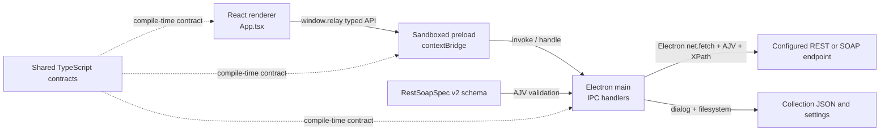

# Relay Architecture

**Scope:** Current Phase 2 implementation
**Last reviewed:** 2026-10-16

This guide documents the implemented application structure. The broader product requirements are in [PRODUCT-SPEC.md](PRODUCT-SPEC.md); current user-visible behavior and limitations are in [FEATURES.md](FEATURES.md).

## System Overview

Relay is an Electron desktop application with a React renderer. OS file access and HTTP execution stay in Electron's main process. The renderer receives a narrow typed API through a sandboxed preload bridge.



## Source Layout

| Path | Responsibility |
|---|---|
| `src/main/index.ts` | Creates the window; executes HTTP requests; substitutes variables; builds bodies and auth headers; runs response assertions; validates imports; protects stored credentials with Electron `safeStorage`; reads and writes workspace files; opens native file dialogs. |
| `src/preload/index.ts` | Exposes the typed `window.relay` API through `contextBridge`; the renderer gets no direct Node.js or filesystem access. |
| `src/renderer/App.tsx` | Owns the React UI and in-memory view state: workspace tree, collection/folder/request selection, request tabs, environment editor, request builder, response viewer, history, import/export actions. |
| `src/renderer/styles.css` | Base renderer styles and responsive layout. |
| `src/renderer/styles-refresh.css` | Active visual layer imported by `src/renderer/main.tsx`. `styles-portal.css` and `styles-hcltech.css` are retained alternate themes and are not loaded. |
| `src/shared/api.ts` | TypeScript contracts shared by main, preload, and renderer. |
| `spec/rest-soap-spec.json` | AJV schema for imported, saved, and exported Relay workspaces/collections. |

Electron windows use `contextIsolation: true`, `nodeIntegration: false`, and `sandbox: true`.

## Workspace Data Model

The persisted document follows `RestSoapSpecEnterprise v2.0`: `info`, optional `environments`, and recursive `items`.

- The document is the **Relay workspace**.
- A top-level item with `type: "collection"` is a named collection.
- A container with `type: "folder"` is a folder; `items` can nest collections/folders and requests.
- A request item has a `request` containing method, URL, params, optional offset pagination, headers, auth, body, extraction rules, and assertions.
- `type` is optional for compatibility. Relay interprets legacy untyped root containers as collections and nested containers as folders.
- Workspace environments contain named key/value pairs. The selected environment applies across all collections and requests in that workspace.

The schema is the data contract, while the shared TypeScript types provide compile-time IPC contracts. AJV validates collection files before loading or saving them.

## Request Lifecycle

1. The renderer keeps the selected request in React state. Opening a tree item opens or activates its request tab. Requests may define JSON Pointer extraction rules in `extractVariables`.
2. Request edits are synchronized back into the selected workspace item and autosaved after a short debounce.
3. When **Send** is clicked, the renderer sends the request and active environment through `window.relay.executeRequest`.
4. The preload invokes `api:execute`; the main process interpolates `{{variable}}` values, appends enabled query parameters, builds headers/auth/body, and calls Electron's `net.fetch`.
5. The main process buffers the response, records duration and body size, then evaluates configured assertions.
6. The response and assertion results return over IPC and render in the response tabs. Request history is held only in renderer memory for the current session.

Collection runs use `collectRunnableRequests` to create a depth-first target list for the selected collection/folder or whole workspace. Before execution, readiness checks block missing/blank environment values and invalid URLs, and ask users to review write methods or requests without response checks. The renderer awaits each `api:execute` IPC call sequentially, applies stop-on-failure/manual-stop behavior, and builds a `CollectionRunReport`. Opted-in offset pagination updates the configured limit/offset parameters for each page, uses a JSON Pointer to count the response array, and records each page separately. A full page at the maximum is reported as potentially incomplete. After each response, JSON Pointer extraction rules can add named values to a temporary run-variable map overlaid on the selected environment for later requests. Extracted values do not change saved environments. Reports include request names, methods, status, duration, response size, assertions, and extraction outcomes, but omit response bodies, headers, and extracted values. `report:export` writes sanitized JSON, Excel-compatible CSV, or standalone HTML through a native Save dialog.

Execution details:

- Supported HTTP methods: GET, POST, PUT, PATCH, DELETE, HEAD, OPTIONS.
- Auth implemented: none, Bearer, Basic, API key in header or query, and per-request OAuth2 password grant. OAuth2 tokens are fetched through the main-process network service and cached in memory until near expiry; client secret, username, and password use `safeStorage` at rest. Authorization-code, client-credentials, device-code, and refresh-token flows are not supported.
- Body modes: none, JSON, XML, raw, URL-encoded, and text-only form-data. File upload is not supported.
- JSON requests default to `application/json`; XML requests force `text/xml; charset=utf-8`; URL-encoded and form-data bodies use their respective encodings. Raw bodies use a user-specified content type when needed.
- SOAP uses the same HTTP dispatcher with a raw XML envelope and a user-specified `SOAPAction` header where required. There is no WSDL parser or SOAP wizard.
- The request timeout is 30 seconds. Network and invalid URL errors return structured failures.
- TLS verification remains enabled. Electron's network service uses the platform certificate store for HTTPS requests.
- Assertions implemented: expected status, AJV JSON Schema, and XPath checks. The Tests tab edits all three; JSON Schema applies to JSON response bodies and XPath applies to XML bodies.
- Offset pagination is opt-in per request and supports query-parameter limit/offset schemes only. Users configure the parameter names, page size, start offset, maximum pages, and response-array JSON Pointer; cursor pagination is not implemented.

## Collection Operations

### Startup and Autosave

On startup, Relay loads the saved workspace. If no saved workspace exists, it starts with the built-in Demo APIs collection. A legacy single-collection Relay document is wrapped in a named collection inside the workspace.

By default, the workspace is stored at `app.getPath('userData')/collection.json`. The hard-drive action opens a native Save dialog, writes the current workspace to the selected JSON file, and remembers its path in `settings.json` under the app's user-data directory. Subsequent autosaves target that file. Writes use a temporary file followed by an atomic rename.

Non-secret workspace data remains JSON. Auth values, explicitly marked key/value rows, and rows with sensitive names are removed from the JSON payload and encrypted with Electron `safeStorage`. Legacy plaintext credentials are migrated atomically during load. If encryption is unavailable, Relay refuses to save non-empty secrets. On Linux, the `basic_text` backend is rejected. Encryption is tied to the local OS account and is not a cross-machine secrets vault.

### Import

The native file dialog accepts Relay JSON only. The main process parses and validates the selected file with AJV before adding it to the current workspace.

- At Workspace root, importing adds a named collection.
- With a collection or folder selected, importing adds a nested folder under that container.
- If the imported file is a full Relay workspace, its top-level items are inserted at root or grouped inside a nested imported folder.
- Existing collections and requests are preserved. Conflicting names are suffixed. Environment name conflicts with different values are retained as separate suffixed environments.

Third-party API-client exports are not converted or imported. Collection scripts are not executed.

### Export

Export snapshots the latest active-request edits and opens a native Save dialog.

- At Workspace root, export writes the whole workspace.
- With a collection selected, export writes that collection and its descendants.
- With a folder selected, export writes that folder and its descendants.
- Export creates a copy and does not change the autosave path. Choosing the current autosave file itself is rejected.
- Export redacts protected values by default. The user must confirm before creating a plaintext export that includes secrets.

## UI State and Current Limits

- Request tabs are session-only; closing a tab closes the view but does not delete the saved request. Tabs are not restored on next launch.
- The active workspace, collections, folders, requests, and environments persist together; request history does not.
- Only one workspace is supported. Multiple collections are supported within it.
- Collections and folders can be created. Requests can be created, renamed, and deleted; folders and collections can be deleted with confirmation. Moving/reordering items and renaming containers are not implemented.
- Collection runner, run readiness, run-scoped JSON Pointer extraction, bounded offset pagination, and sanitized JSON/CSV/HTML report export are implemented. Extraction and pagination work only during collection runs; individual requests use only the selected saved environment and send once.
- Third-party collection import/conversion, OAuth2 grants other than password, refresh-token handling, form-data file upload, request-history replay, and working Settings/workspace-switcher actions are not implemented. Copy as cURL is implemented in the main process and requires confirmation before writing potentially sensitive request data to the clipboard.

## Development Checks

From the project directory:

```powershell
npm run dev
npm test
npm run typecheck
npm run build
```

`npm test` runs the offline schema/fixture suite. `npm run build` builds the Electron main, preload, and renderer bundles only. Windows installer and portable packaging use the separate `package:win` and `package:portable` scripts.
